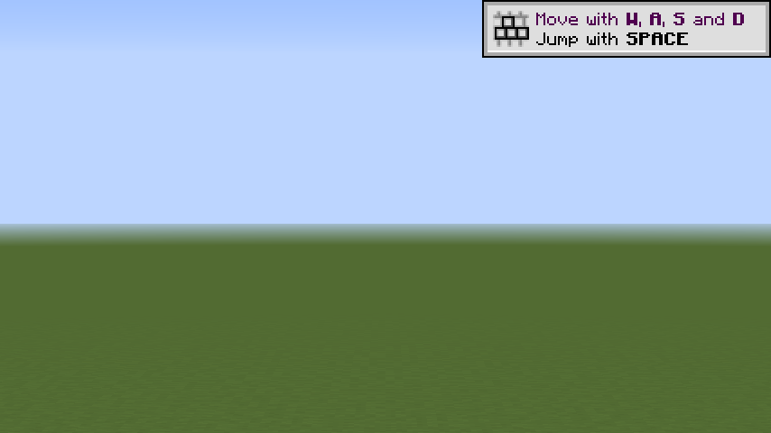
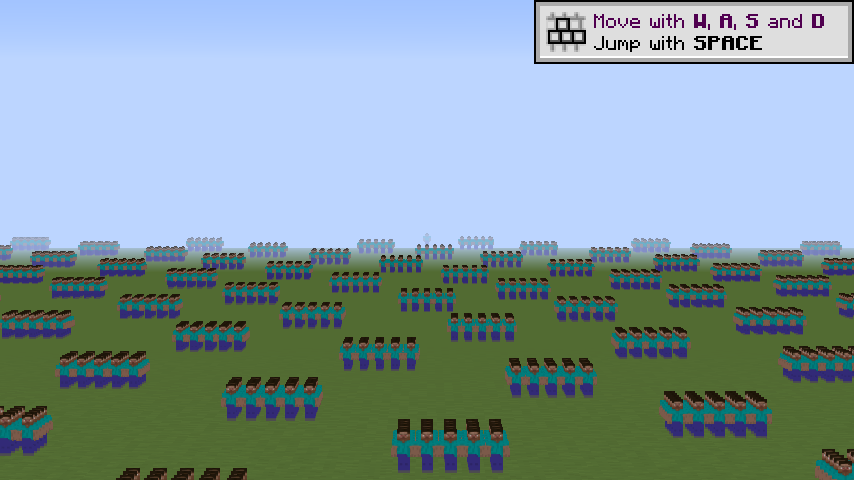
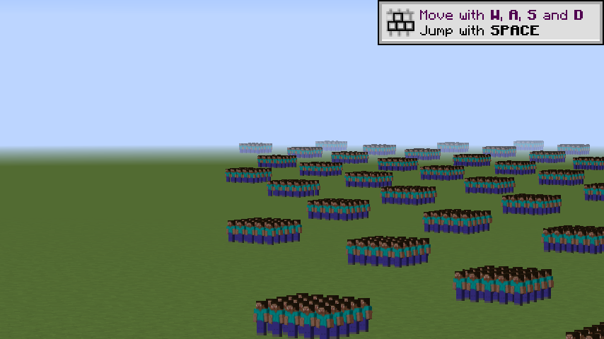
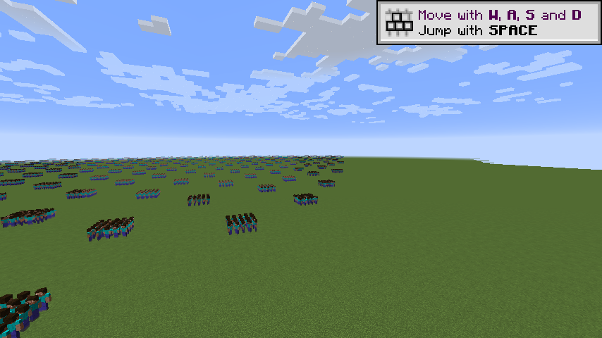

# M5-V.8 — sprejem vidnosti NPC-jev na daljavo (A/B `RwFarView` 0 / 1 / 2), 2026-10-22

Paket M5-V.8 (D-034, D-035). Celice M5-V.1 z dometom sledilnika 64 (vd 10 / 24 × N 1.000 / 5.000), vsaka v treh
variantah, **3 ponovitve** vsaka (12 serij, 36 zagonov). Nočni upravljalnik, koda `9f9125b0…` (testi `unit`, `build`,
`package` in `v8-{10,24}-{1000,5000}-f{0,1,2}` zeleni). Scenarij: [M5-V.1-dalec.md §M5-V.8](../scenariji/M5-V.1-dalec.md).
Poročila `audit/m25c-sprejem-2026-10-22-<čas>.md` so git-ignorirana, zato so tabele prepisane spodaj.

## 1. Pogoji

- Dedicirani strežnik (`dev/run`, svež svet `rwv-dalec` na zagon) + dev klient, FOV 70, 854 × 480, vsync 0, limit 260,
  kamera fiksna; 30 s ogrevanja, 60 s merjenja (kot M5-V.1). `dev/run/config/CustomNpcs.cfg` ima `RwFarView=0`,
  varianto nastavi harness ob vstopu.
- `-Far 0` original; `-Far 1` strežnik `rwfar 1` (domet 384) + klient 1 (L3 onkraj 64); `-Far 2` isto + klient 2
  (L2 56..64, `RwImpostorStart` 56). Prizorišče je v vseh treh enako (gruče M5-V.1 + sonda na `(vd − 1)·16`), zato je
  izhodišče `-Far 0` te serije, ne številke M5-V.1.
- Po merjenju: hoja kamere 48 blokov nazaj in naprej (V25, ~22,4 s), pri `-Far 1/2` šiv V24, nato posnetki V26.
- Veljavnost: v vseh 36 zagonih zelene vse preverbe (`-Far 0`: 26, `-Far 1/2`: 35; V0–V26, T1–T6); odtis enak v vseh
  ponovitvah serije. V24 v vseh 24 zagonih z `rwfar`: **0 vrzeli, 0 dvojnih**. Nadomestki = pas (V17), 1 videz (V19),
  0 nadomestkov brez peke (V20), izris v vsaki sličici (V22).

## 2. Rezultati (mediana treh ponovitev, ms; v oklepaju sprememba proti `-Far 0`)

| vd / N | `RwFarView` | sličica p50 | **p95** | p99 | FPS | 1 % low | narisanih L3 / L2 | izris µs povp. |
|---|---|---|---|---|---|---|---|---|
| 10 / 1000 | 0 | 1,188 | 1,286 | 1,545 | 828 | 530 | — | — |
| 10 / 1000 | 1 | 1,246 | 1,360 (+0,074) | 1,606 | 789 | 500 | 176 / 0 | 50 |
| 10 / 1000 | 2 | 1,254 | 1,366 (+0,080) | 1,620 | 784 | 531 | 176 / 0 | 52 |
| 10 / 5000 | 0 | 4,408 | 4,936 | 5,742 | 222 | 128 | — | — |
| 10 / 5000 | 1 | 4,606 | 5,115 (+0,179) | 5,764 | 213 | 137 | 761 / 0 | 199 |
| 10 / 5000 | 2 | 3,161 | **3,658 (−1,278)** | 4,005 | 309 | 186 | 761 / 70 | 227 |
| 24 / 1000 | 0 | 3,029 | 3,656 | 4,216 | 319 | 171 | — | — |
| 24 / 1000 | 1 | 3,295 | 3,961 (+0,305) | 4,641 | 292 | 161 | 976 / 0 | 253 |
| 24 / 1000 | 2 | 3,295 | 4,024 (+0,368) | 4,817 | 291 | 156 | 976 / 0 | 252 |
| **24 / 5000** | 0 | 7,320 | 9,188 | 12,074 | 131 | 74,0 | — | — |
| **24 / 5000** | 1 | 9,038 | **10,873 (+1,685)** | 14,405 | 107 | 61,7 | 4.831 / 0 | 1.253 |
| **24 / 5000** | 2 | 7,228 | **8,893 (−0,295)** | 11,308 | 135 | 75,8 | 4.831 / 70 | 1.283 |

Razponi p95 (relativni): 0,1–12,8 %; pri 24/5000 f0 1,172 ms (12,8 %), f1 0,527, f2 0,284. Pri 24/5000 sta f1 in f0
ločena (f1 min 10,627 > f0 max 9,808); f2 in f0 se prekrivata (f2 8,872–9,156, f0 8,636–9,808) → f2 je
**enak originalu v okviru šuma**, ne dokazano hitrejši. Pri 10/5000 je f2 ločeno hitrejši (L2 70 od 170 sledenih).

| vd / N | `RwFarView` | MSPT p50 / p95 | `rwfar` µs/tick/igralca | klientski tick p50 | B/s mirovanje (žica / `rwfar`) | B/s hoja (žica / `rwfar`) |
|---|---|---|---|---|---|---|
| 10 / 1000 | 0 / 1 / 2 | 1,114 / 1,638 · 1,147 / 1,638 · 1,147 / 1,638 | — / 6,5 / 6,2 | 0,303 / 0,315 / 0,314 | 169 / 165 / 176 · `rwfar` 0 | 1.632 / 1.718 / 1.700 · `rwfar` 0 / 85 / 87 |
| 10 / 5000 | 0 / 1 / 2 | 7,995 / 10,748 · 7,995 / 10,748 · 8,258 / 10,748 | — / 10,3 / 11,7 | 0,496 / 0,491 / 0,505 | 1.076 / 1.101 / 1.071 · 0 | 7.835 / 7.650 / 7.643 · 0 / 516 / 513 |
| 24 / 1000 | 0 / 1 / 2 | 7,209 / 8,913 · 7,471 / 9,437 · 7,471 / 9,437 | — / 19,9 / 18,8 | 0,605 / 0,598 / 0,603 | 174 / 174 / 171 · 0 | 2.041 / 2.082 / 2.057 · 0 / 105 / 105 |
| 24 / 5000 | 0 / 1 / 2 | 54,526 / 60,817 · 55,575 / 62,915 · 54,526 / 61,866 | — / **88,4** / **91,5** | 0,867 / 0,867 / 0,879 | 986 / 968 / 985 · **0** | 7.875 / 8.035 / 8.013 · 0 / **513** / **513** |

MSPT razponi pri 24/5000 so 3,1–4,2 ms (D-043: MSPT ne razloči 0,1 ms), zato strežniško stran sodi števec `rwfar`.

## 3. Presoja proti ciljem D-034 / D-035

| Cilj | Merilo | Izmerjeno (24 / 5000) | Izid |
|---|---|---|---|
| NPC viden na ≥ 368 blokih (dedicirani strežnik, vd 24, RD 24) | V23 + posnetki | sonda na 368,0 blokih v pravi sličici (114 spremenjenih pikslov v p1), V26 368 vidni impostorji (slika spodaj); original na 368 nič | **izpolnjeno** |
| Dodatni čas sličice p95 ≤ 1,0 ms pri 5.000 oddaljenih | mediana p95 proti `-Far 0` | `RwFarView=2`: **−0,295 ms**; `RwFarView=1`: **+1,685 ms** | **izpolnjeno za 2** (privzeta vrednost klienta po D-035), **ne za 1** |
| Strežnik +≤ 0,1 ms na igralca | `rwfar` µs na tick na igralca (D-043) | 88,4 / 91,5 µs | **izpolnjeno** (blizu meje, 8,5 µs rezerve) |
| Omrežje mirovanje ≤ 1 KB/s na igralca | `far.bajti.s` | 0 B/s (samo spremembe); žica 986 → 985 B/s | **izpolnjeno** |
| Omrežje hoja ≤ 20 KB/s na igralca | `hoja.far.bajti.s` | 513 B/s; žica 7.875 → 8.013 B/s (+1,8 %, v razponu f0 689 B/s) | **izpolnjeno** |
| VRAM ≤ 32 MB [K] | atlas 2048² × 4 B × 4/3 + FBO peke 128 × 256 (barva + globina) | 21,33 + 0,25 ≈ **21,6 MiB** (izračun, ne meritev) | **izpolnjeno [K]** |
| Meja 64 brez vrzeli in dvojnih | V24 | 0 / 0 v 24 zagonih (pri f2 tudi meja model ↔ L2) | **izpolnjeno** |
| Zasnova: B cenejša od A na vseh treh straneh | V.1 §4 | sličica A +184 ms p95 proti B −0,3; omrežje A +28,4 KB/s proti B 0; strežnik A pod ločljivostjo MSPT, B 91,5 µs z lastnim števcem | **izpolnjeno** (strežnik: oba pod ločljivostjo MSPT, B ima dokazano mejo) |

**Sklep (D-051):** sprejemni cilji D-035 so izpolnjeni pri `RwFarView=2` → privzeta vrednost postane **2** (en ključ za
obe strani: strežnik pošilja pri ≥ 1, klient riše L2 + L3). Sprememba privzete vrednosti v kodi je ločen paket
M5-V.8b (unit/build/package), ker bi sprememba kode razveljavila odtis teh meritev.

**Pošteno zapisano:**
- **L3 sam (`RwFarView=1`) cilja sličice ne izpolni**: +1,685 ms p95 pri 4.831 impostorjih (izris povp. 1,25 ms).
  Vrednost 1 je zato samo za strežnik / klient brez L2 in ni priporočena za klient. Pri 2 L2 izniči ceno L3, ker
  70 od 170 sledenih NPC-jev nadomesti model. Na prizorišču, kjer onkraj 56 blokov ni sledenih NPC-jev (npr. 5.000
  oddaljenih, 0 bližnjih), bi L2 ne kompenziral in dodatek bi bil ~1,7 ms → kandidat optimizacije (cena izrisa L3:
  ~0,26 µs na impostor; zapisovanje oglišč vsako sličico).
- f2 pri 24/5000 je enak originalu v okviru šuma (razpona se prekrivata), ne hitrejši.
- `rwfar` 91,5 µs je 8,5 % pod mejo 100 µs; ob več NPC-jih ali igralcih je meja blizu (kandidat: pas po chunkih).
- Peka enega videza: 26–34 ms (ena sličica ob vstopu; kandidat PBO).
- Ročna preverba z OptiFine (s senčili in brez) ostaja odprta (M5-V.7, odvisna od uporabnika).

## 4. Posnetki (V26, ponovitev 1, 24 / 5000)

Original (`RwFarView=0`), pogled v NPC pri ~368 blokih, FOV 10 — NPC-jev ni:

`RwFarView=2`, isti pogled — impostorji do roba pasu (zadnje vrste v megli):

`RwFarView=2`, 256 blokov, FOV 10:

`RwFarView=2`, 128 blokov, FOV 70 (bližnji modeli spodaj levo, L2/L3 dlje):

## 5. Omejitve

- En stroj, en igralec; strežniški števec `rwfar` je na igralca, linearnost z več igralci ni izmerjena.
- Prizorišče ima en videz (kloni `PERF_Idle`) → 1 peka; z mnogo videzi je cena peke ob vstopu večja (D-046).
- VRAM je izračun [K], ne meritev gonilnika.
- Starejši poskusni seriji `0837/0847/0857` (drugačen odtis kode) nista del presoje.
